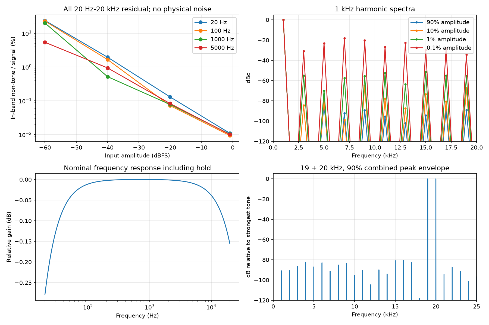
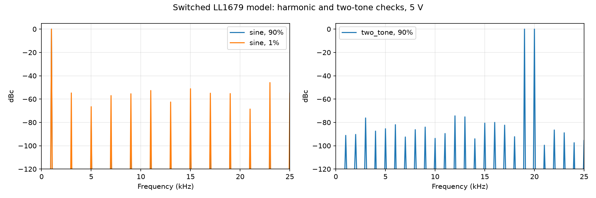

# Preliminary audio viability review

## Decision checkpoint

Assess audio quality before spending more effort on shutdown sequencing or FPGA
implementation. The present 12-bit, undithered design is not yet a demonstrated
low-distortion universal hi-fi amplifier. Large-signal model distortion is low,
but small-signal quantization and high output impedance are material weaknesses.
It remains a plausible research topology for a defined load, conditional on
accepting its load dependence and finding a satisfactory low-level solution.

These results do not predict complete hardware THD: the transformer is linear,
so core-generated harmonics, saturation and hysteresis are absent by construction.
No physical noise, driver coupling, thermal drift or high-voltage nonlinear
switch model is included. Do not describe these figures as measured amplifier
performance or as an upper bound on hardware distortion.

## Quantization and static resistor screen

The executed screen includes 272 single-tone records: 20/100/1000/5000 Hz,
90/10/1/0.1% full-scale amplitude, ideal resistors, and eight seeded networks
each at +/-0.01% and +/-0.1% independent resistor tolerance. Another 51 records
use equal-amplitude 19/20 kHz tones at three combined peak-envelope levels.
No dither or error feedback is enabled. All records use 192 kS/s, 0.1 seconds,
coherent FFT bins and an ideal sample hold. The network is the fixed 3+9 DAC,
followed by the LL1679/PP B linear model with assumed 100 pF primary capacitance
and 100 kohm core loss.

The exact static transfer table is calculated from all branch conductances,
including grounded terminations. Its ideal case is checked against the known
12-bit linear mapping. Parseval energy checks are executed for every single-tone
record. Tolerance samples are sensitivity examples, not worst-case bounds.

At 1 kHz with ideal resistors:

| Input amplitude | Level relative to full scale | THD, harmonics 2-20 |
|---|---:|---:|
| 90% | -0.92 dBFS | 0.01029% |
| 10% | -20 dBFS | 0.07763% |
| 1% | -40 dBFS | 0.51808% |
| 0.1% | -60 dBFS | 20.03772% |

These are voltage-amplitude percentages, not power percentages. At 0.1%
amplitude, the input peak spans only about two 12-bit code steps. The resulting
relative distortion is high despite the small absolute output. This finding
also agrees with the earlier quantization study; it is not evidence of a
large-signal 20% distortion mechanism in the switches.

At 20 Hz, the ideal-resistor in-band THD is 0.01093% at 90% amplitude,
1.95212% at 1%, and 23.80179% at 0.1%. A linear transformer cannot establish
actual low-frequency core distortion, which could dominate these numbers.

At 1 kHz / 90%, the eight +/-0.01% resistor examples give THD from 0.01020%
to 0.01085%; +/-0.1% gives 0.01536%-0.01884%. At 1% input the latter range
becomes 0.54463%-0.85587%. Better resistors alone do not remove the low-level
quantization problem.

THD includes only harmonics within 20 kHz; the number included therefore changes
with input frequency. Quantization aliases can also fall at nonharmonic bins.
The plotted all-in-band residual includes every 20 Hz-20 kHz bin except the
fundamental, so a tiny 5 kHz THD must not be mistaken for a tiny total residual.
The reported spectral SINAD is quantization/static-only, not measured SNR or
hardware dynamic range. In particular, a deterministic silent code says nothing
about the actual analog noise floor.

## Two-tone results: static model only

At 19 + 20 kHz, 90% combined peak envelope, ideal resistors:

- 1 kHz difference component: 0.002867% of the mean individual tone amplitude.
- RSS of the 18/21 kHz components: 0.001338% of the RSS of the two wanted tones.
- All unwanted 20 Hz-20 kHz content: 0.015737% of the wanted-tone RSS.

These explicitly defined products are not a claimed standards-compliant IMD
instrument measurement. The 21 kHz component lies outside the stated audio band
but is retained in the third-order product metric. Physical switch effects need
the separate switched-model check; the static numbers must not substitute for it.

## Frequency response and load interaction

Four executed ngspice AC sweeps independently verify gain for 4/8/16 ohm loads
and the small-signal output impedance. Maximum relative disagreement with the
complex-impedance equations is below 6e-14.

For 8 ohm, including ideal hold, gain relative to 1 kHz is -0.279 dB at 20 Hz
and -0.156 dB at 20 kHz. This is a favorable nominal resistive-load response.
However, output impedance is about **8.327 ohm at 1 kHz**, giving an 8 ohm load /
output-impedance ratio of only **0.961**. At unchanged source drive, switching
from 8 to 4 ohm changes 1 kHz gain by -3.580 dB; 8 to 16 ohm changes it by
+2.557 dB. These are separate resistive-load examples, not a measured loudspeaker
frequency response. A real speaker's frequency-dependent complex impedance
requires explicit evaluation and may materially change the tonal balance.

Earlier candidate-transformer calculations project approximately 4.34 W at
650 V and 5.04 W at 700 V full-scale drive at 1 kHz, with the assumed core-loss
resistance. They are linear power projections, not evidence of a 5 W hardware
THD result. The 20 Hz power target is less favorable.



## Reproduction and scope of this checkpoint

```powershell
python calc/audio_viability.py
python sim/audio_viability_ac.py
```

Quantitative results: `results/audio_viability/spectral.json` and
`results/audio_viability/ac_checks.json`. AC decks are in
`sim/generated/audio_viability/ac_*.cir`.

Full switched harmonic/two-tone checks are a separate result set. The historic
switched 10 H-transformer results (approximately 0.0107% at 90% amplitude and
0.531% at 1%) support the broad concern but must not be silently relabeled as
LL1679 results. The new benchmark uses the LL1679 model consistently.

## Completed switched-model check

Six retained structural ngspice transients now use the LL1679 candidate model,
32 half-bridges, fixed 20 pF per transistor, 0.35 ohm Ron, generic rail clamps,
200 ns command blanking and 2 ns conductance edges. Requests are rounded to a
50 MHz grid. The supply is 5 V; these are not vendor-device HV results.

| Signal | Switched model | Ideal held-code reference with the same request times |
|---|---:|---:|
| 1 kHz, 90% amplitude: THD H2-H20 | 0.01097% | 0.01060% |
| 1 kHz, 1% amplitude: THD H2-H20 | 0.53024% | 0.51913% |
| 19/20 kHz, 90% envelope: 1 kHz difference / mean tone | about 0.003% | about 0.0029% |
| Same two tones: 18/21 kHz RSS / wanted-tone RSS | about 0.0019% | about 0.0013% |
| Same two tones: total in-band unwanted / wanted-tone RSS | about 0.0261% | about 0.0260% |

The ideal references here include the rounded 50 MHz update times, while the
static screen above has uniform sampling. Their differences, especially for
high-frequency two-tone tests, must not all be attributed to switch nonlinearity.
The 0.1%-amplitude 20% THD result remains a static/quantization result; no new
switched check at that amplitude is claimed.

For each signal, maximum timestep is reduced from 500 to 250 ns. The primary
THD/third-order-product metric changes by at most 0.0000635 percentage points.
The last 20-30 ms analysis window is compared with 10-20 ms. Third-order
products change by 0.0000545 percentage points between those windows; the very
small 1 kHz difference component varies approximately 0.00275%-0.00323% across
windows/steps, so reporting six decimal places for it would imply false precision.
This check finds no catastrophic large-signal switching or two-tone failure in
the surrogate. It does not eliminate the low-level problem or qualify core THD.

### Treatment of startup in the spectral measurement

The ngspice operating point starts with a held code, so a slow magnetic transient
is superimposed on the periodic audio. Ten 1 ms period means are fitted to a
constant plus an exponential with the independently established 30.874 ms time
constant. That fitted component is removed before the coherent 10 ms FFT.
Period averaging preserves the periodic harmonics and 1 kHz-spaced two-tone
products. A synthetic check recovers a known 0.003% difference tone despite an
added DC/exponential tail. Both raw and corrected metrics are retained in JSON.

This correction is consequential: the raw two-tone window contains about
2.66% in-band non-tone content, dominated by the startup tail; the fitted tail
at 20 ms is about 9.47 mV. The corrected 0.0261% is a preliminary periodic-audio
estimate, not a claim that startup behavior has disappeared. The time-constant
assumption and preceding-window comparison limit its precision. A fully settled
long-record check is appropriate if a later design decision hinges on much
smaller differences; it is not required to discover the present architectural
limitations. Noise and nonlinear magnetic behavior remain absent.



```powershell
python sim/audio_viability_switched.py
# Fast standalone numerical-analysis check:
python sim/audio_viability_switched.py --check-analysis
```

Results: `results/audio_viability/switched.json`, per-run metrics/logs, and
`detrend_check.json`. The six structural decks are retained alongside the AC
checks. The benchmark uses direct command generation, not mute-controller RTL.

## What remains before a go/no-go decision

The present screen already justifies pausing detailed implementation. The bounded
switched harmonic/two-tone check is complete and does not expose another large
failure in the nominal surrogate. Decide whether to accept high output impedance
and pursue one low-level quantization remedy before more detailed engineering. Existing error-feedback studies are relevant,
but their reduced in-band error comes with additional switching activity; a low
THD harmonic-bin number alone must not hide added noise or power loss.

For a credible hardware-quality prediction, validated nonlinear transformer and
switch behavior and a noise/loss budget remain necessary. There is no meaningful
fixed count of simulations that substitutes for those missing model inputs.
Further mute optimization and FPGA selection are deferred behind this audio
viability decision.
