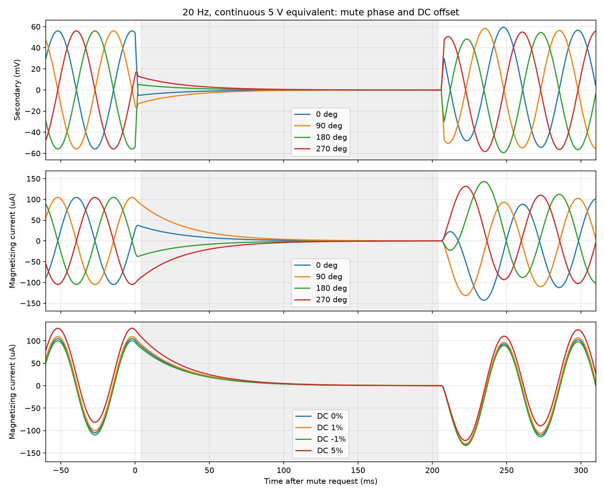

# Low-frequency mute, long quiet holds and PCM DC offset

## Decision

The 2 ms audio fade / 2 ms common-mode transition remains a 1 kHz reference,
not a completed full-band mute solution. At 20 Hz the linear model retains
magnetizing current after the source reaches zero. A longer quiet hold allows
it to decay but does not remove the initial output tail. Startup and resume
also depend on signal phase.

Complete the simulation work before selecting an FPGA vendor, device, price
point or implementation flow. Existing HDL may supply test commands, but no
FPGA implementation or physical schematic change is made in this study.

## Executed coverage

35 ngspice runs completed: 16 transient conditions at two maximum timesteps,
plus three independent DC operating-point checks. Conditions combine:

- A 20 Hz cosine at 90% of the nominal differential full-scale source range.
- Source phases 0, 90, 180 and 270 degrees at the mute request.
- Input DC offsets 0%, +1%, -1% and +5% of normalized PCM full scale.
- Startup, five settled audio periods, mute, a 200 ms parked interval, and resume.

```powershell
python sim/low_frequency_mute.py
```

Results: `results/low_frequency/summary.json`; generated circuits:
`sim/generated/low_frequency/`; waveform plot: `plots/low_frequency/comparison.png`.
`partial.json` is a progress checkpoint; the completed summary is authoritative.

## Results at zero PCM offset

All voltages and currents below belong to the **5 V equivalent model**.

| Source phase at mute | Steady peak magnetizing current, uA | Current at park, uA | Peak output during park, mV | Peak current on startup, uA | Peak current on resume, uA |
|---|---:|---:|---:|---:|---:|
| 0 deg | 104.855 | 35.136 | 4.827 | 108.946 | 142.936 |
| 90 deg | 104.922 | 88.137 | 12.109 | 153.284 | 131.399 |
| 180 deg | 104.855 | -35.136 | 4.827 | 108.946 | 142.936 |
| 270 deg | 104.922 | -88.137 | 12.109 | 153.284 | 131.399 |

The 90/270-degree cases leave about 88.1 uA at park and a 12.109 mV output tail.
These are source-voltage zero crossings; a source-voltage zero crossing is not
necessarily a low-energy magnetic state. In this fixture, the 0/180-degree
cases have smaller tails, but four phases do not prove a worst-case bound.

The slowest linear time constant is **30.874 ms**. After reaching park, current
falls below 1% of its initial parked magnitude after about **142.19 ms**.
After 200 ms, approximately 0.154% remains. This is a relative settling criterion,
not a universal silence threshold or a requirement to delay every mute by 142 ms.
At zero offset, the largest end-of-hold output magnitude is about 18.62 uV.

The largest zero-offset startup magnetizing peak is 153.28 uA versus about
104.92 uA in settled operation (roughly 46% higher). Resume reaches 142.94 uA
in another phase case. Thus removing PCM DC alone does not eliminate phase-
dependent startup/resume excursions. The linear model cannot say whether these
values would saturate a real core.

## DC offset

At DC, the ideal primary inductance shorts its terminal voltage, while the
secondary steady voltage is zero. Therefore the modeled primary DC current is

`I_DC = (5 * 4095/4096 * PCM_offset) / (2 * R_DAC + R_primary)`.

Three ngspice operating-point calculations match that independent expression:

| PCM offset | Primary DC current |
|---|---:|
| 1% | 4.667656 uA |
| -1% | -4.667656 uA |
| 5% | 23.338281 uA |

A transformer can block DC at the speaker while its primary still carries DC.
In the combined +5%-offset / 90-degree case the parked output tail reaches
15.018 mV and the parked magnetizing current is 109.31 uA. Across all offset and
phase cases, the largest startup-or-resume magnetizing current is 165.59 uA.

The input offset is faded with the audio envelope; hardware mismatch or bias
that persists after mute is a different problem and is not covered here.
Suppressing input DC before the DAC is a candidate to test, not a newly added
filter or an established protection mechanism.



## Equivalent circuit and timing

The differential source has nominal range factor 5 * 4095/4096 V and drives
2 * R_DAC + 160 ohm into the LL1679/PP alternative-B linear model. R_DAC is the
existing 3+9 nominal per-arm Thevenin resistance. Winding parameters are 150 H
primary, turns ratio 34.5, leakage 8 mH and 0.2 ohm secondary DCR; the load is
8 ohm. Core loss (100 kohm) and primary capacitance (100 pF) are assumptions.

Differential gain rises from zero at 2 ms to full at 4 ms. Mute starts at
254 ms, gain reaches zero at 256 ms and park begins at 258 ms. Common-mode
motion has no differential effect in this matched equivalent. Park lasts to
458 ms; resumed gain rises over 460-462 ms, and simulation ends at 712 ms.
The source oscillator continues running through mute. The source phase quoted
in the table is defined at 254 ms.

This is a **continuous Thevenin equivalent**, not 192 kS/s held PCM or replay of
individual transistor commands. It includes neither 12-bit rounding nor Coss,
blanking, rail-clamp currents, arm skew or resistor mismatch. Its purpose is to
isolate low-frequency magnetic memory and DC bias over long intervals. It does
not establish switching losses, distortion, audibility or protection ratings.

Magnetizing current is `Ip + (M/Lp) * Is` with the coupled-inductor dot convention.
Primary flux linkage is `Lp * I_magnetizing`, and coupled magnetic energy is
`0.5*Lp*Ip^2 + 0.5*Ls*Is^2 + M*Ip*Is`. Linkage is not flux density: actual turns,
core area and a validated nonlinear core model would be needed for saturation
assessment. No 650 V stress or core qualification follows by scaling these runs.

## Numerical verification

Each transient is repeated with maximum steps of 100 and 50 us, Gear integration,
relative tolerance 1e-8 and current tolerance 1e-14 A. Measurements use a 10 us
grid. Steady DC estimates average the final complete 20 Hz period before mute;
startup peaks cover the first 54 ms; resume peaks cover 458-712 ms.

A separate state-space solution uses states Ip, Is and primary voltage, with
coupled-inductance matrix inversion and eigenmode propagation for linearly
interpolated input on the 10 us grid. It shares physical parameters but not the
ngspice integrator. All 16 cases are compared against it. DC checks use a
separate algebraic resistance calculation.

Maximum quiet-output peak change under timestep refinement: 0.2048 uV. Maximum independent output difference: 2.4592 uV; maximum magnetizing-current difference: 2.3655 nA. All stated checks passed.

## Next simulation decision

Compare longer audio fades (for example 10, 25 and 50 ms) and input DC rejection
in this same phase/offset matrix before changing controller logic. Evaluate both
the output tail and peak magnetizing current; reducing one does not automatically
minimize the other. Then replay selected cases in the switched model. Loss of
load, loss of drive and bias-collapse tests remain separate pending work.
