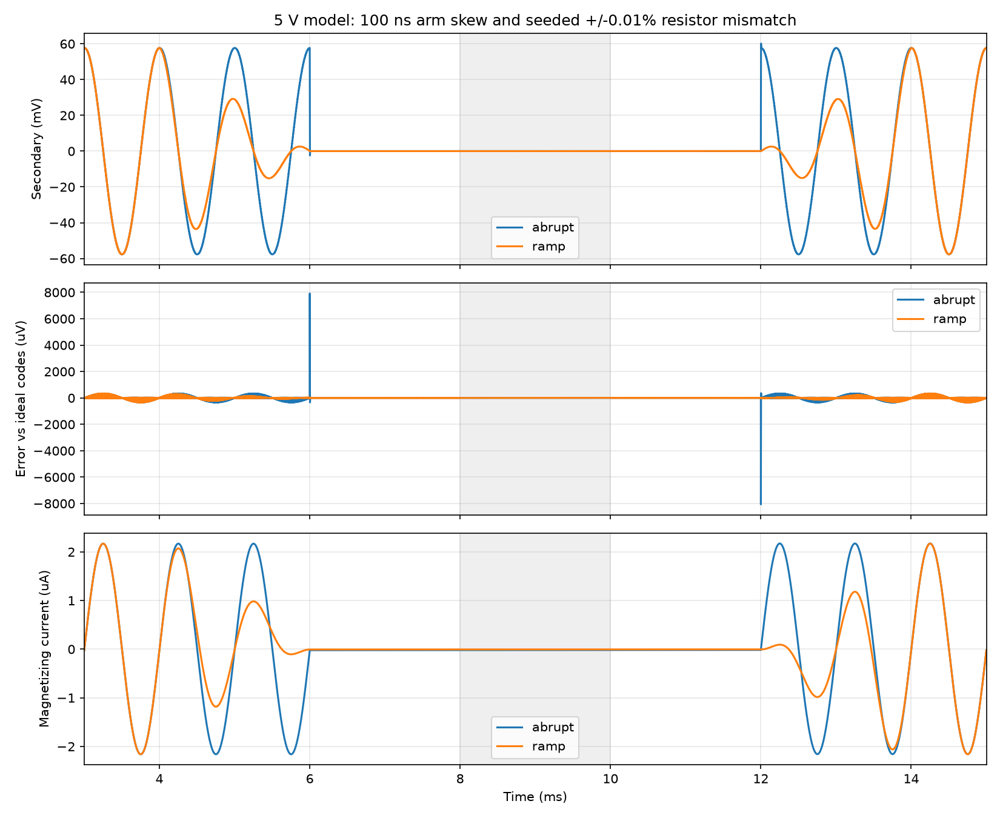

# Audio-to-quiet transition study

## Result and working decision

All 16 retained ngspice runs completed, including timestep refinement. Adopt
**2 ms differential fade + 2 ms common-mode movement + all-low hold**, with
the reverse sequence on resume, as the working healthy-control mute candidate
for the next controller implementation. This decision applies to the tested
1 kHz / 192 kS/s / 8 ohm fixture; it is not a hardware or universal click-free
qualification. The current HDL and KiCad circuit are unchanged.

For 100 ns arm skew plus the seeded +/-0.01% resistor mismatch, transition-error
peak falls from **8.061 mV to 0.306 mV (26.3 times)**. Error RMS over 4-14 ms falls
from **135.47 uV to 40.21 uV (3.37 times)**. Each sequence is compared with its own
ideal held-code reference, so the intentional fade is not counted as an error.

| Sequence | Case | Peak error, mV | Error RMS, uV | Quiet output RMS, uV | Quiet mean primary current, nA |
|---|---|---:|---:|---:|---:|
| abrupt | nominal | 8.2832 | 132.234 | 1.800 | -6.579 |
| abrupt | skew | 8.0535 | 135.427 | 1.893 | -6.918 |
| abrupt | skew_mismatch | 8.0610 | 135.469 | 2.572 | -9.401 |
| ramp | nominal | 0.2467 | 32.341 | 0.134 | -0.488 |
| ramp | skew | 0.3056 | 40.198 | 0.229 | -0.838 |
| ramp | skew_mismatch | 0.3063 | 40.208 | 0.946 | -3.460 |

Quiet values are illustrative finite-window model residuals, not physical noise
or validated sub-microvolt accuracy. They are small compared with the global
numerical error bounds below. The principal decision rests on the much larger
transition-error improvement, not those tiny residuals.

With combined skew/mismatch, the peak output over 6-12 ms is 57.680 mV for
abrupt interruption and 0.141 mV for the ramp. The abrupt window includes the
interrupted signal at its boundary; this ratio must not be presented as a
standalone suppression factor for switching glitches. Peak modeled magnetizing
current over the whole run is 2.173 / 2.171 uA respectively, mostly during audio.
No flux-density or saturation conclusion follows from this linear model.



Largest structural peak-error change on timestep refinement: 0.0688 uV. Largest reference pointwise output change: 1.1299 uV. Both checks passed.

## Scope and proposed sequence

This study tests a proposed healthy-control sequence in the 5 V structural 3+9
network with the LL1679/PP alternative-B linear transformer and an 8 ohm load.
It does not alter the HDL, schematic, or all-gates-off fault response.

The proposed `ramp` sequence is:

| Time | Action |
|---|---|
| 0-2 ms | Fade a 1 kHz cosine from zero to 90% amplitude. |
| 2-4 ms | Play at 90% amplitude. |
| 4-6 ms | Fade differential amplitude to zero. |
| 6-8 ms | Move both arms together from midpoint toward code zero. |
| 8-10 ms | Hold all lower switches on and all upper switches off. |
| 10-12 ms | Move both arms together back to midpoint. |
| 12-14 ms | Fade the audio back to 90% amplitude. |
| 14-16 ms | Continue audio. |

An `abrupt` comparison uses the same initial fade, switches straight from audio
to all-low at 6 ms, and resumes full audio at 12 ms. These times coincide with
a cosine peak, intentionally making abrupt interruption unfavorable. The 2 ms
ramps are test choices, not optimized values or a universal click-free guarantee.

Samples run at 192 kS/s, with request times rounded to a 50 MHz clock. Only
changing branches are blanked. The previous channel begins turning off at the
request; the new channel begins turning on 200 ns later. Conductance edges last
2 ns, giving 198 ns with both channels fully off. A separate 100 ns delay on
arm B exercises arm skew. Unchanged branches stay on.

The two arm codes are generated independently during the sequence. Equal
rounded midpoint codes produce exactly zero commanded differential voltage;
the ordinary complementary decoder does not support the all-low quiet state.
This is a candidate command generator, not RTL co-simulation.

## Models and comparisons

The structural model uses 0.35 ohm on resistance, 1 Tohm off resistance,
20 pF per transistor, and generic 0.7 V / 2 ohm rail clamps. Transformer values
are 150 H primary inductance, 34.5 turns ratio, 8 mH leakage and 160/0.2 ohm
winding resistances. Core-loss resistance (100 kohm) and primary capacitance
(100 pF) remain assumptions. No nonlinear core or validated vendor device is
included, and the ideal supply remains present throughout.

Each sequence is tested nominally, with 100 ns arm skew, and with that skew
plus one reproducible realization of independent uniform +/-0.01% branch and
termination resistor errors (seed 20261115). This is a sensitivity example,
not a mismatch population or worst-case guarantee.

For each policy, an independent ideal reference drives the same transformer
with two held-code Thevenin sources: 5 * code / 4096 V, each through the nominal
per-arm resistance. It includes the same quantized input sequence and 2 ns
source edges but no blanking, skew, mismatch, switch capacitance or on resistance.
Error against this reference therefore measures their combined effect, not
blanking alone. The deliberately interrupted audio is part of the reference;
reference-error peaks are not the entire audible interruption.

Analysis resamples adaptive ngspice output at 100 ns. Quiet metrics use 9-10 ms;
transition error uses 4-14 ms. Primary-current window means are finite-window
values, not steady-state DC. Magnetizing current is computed as Ip + (M/Lp)*Is
using the coupled-inductor dot convention, removing the load-current component.
The short quiet interval does not establish complete magnetic discharge.

## Reproduction

```powershell
python sim/quiet_transitions.py
```

Generated netlists: `sim/generated/quiet_transitions/`.
Results and simulator log: `results/quiet_transitions/`.
Plot: `plots/quiet_transitions/comparison.png`.

## Controller implications

Use an explicit mute request for this sequence; this study does not justify
an automatic amplitude threshold that might suppress quiet musical passages.
The experiment applies the amplitude envelope before 12-bit quantization. An
implementation fed only already-quantized 12-bit PCM needs separate evaluation.

A future controller needs independent arm targets during common-mode movement,
latched timing states for fade/center/park/recenter/resume, and the existing
per-branch blanking behavior. Emergency gate disable must retain priority.
Holding lower channels on is conditional on healthy bias and control. Error
feedback and dither must not keep toggling the parked output; resuming their
internal states is another transition to test before adoption.

The existing controller has an approximately 1 ms valid-sample watchdog. A
parked state must continue receiving supervised heartbeat/refresh events, or
provide an explicitly designed equivalent supervision contract. Simply stopping
sample requests for this 2 ms quiet interval would trigger the existing fault
path. Repeated identical commands need not switch any branch. Do not disable
the watchdog merely to make silence work.

Parking removes code-driven switching in this model and the normal midpoint
resistor dissipation after settling. It does not remove isolated-driver bias
power, controller power, leakage, or the energy dissipated during transitions.
No new high-voltage thermal-loss claim is derived from these 5 V waveforms.

## Remaining coverage before a broader claim

This is one 1 kHz waveform and interruption phase, one load, one skew direction,
and one resistor-error realization. Interrupting at a voltage peak is not a
worst-case magnetic-energy test. Repeat with low-frequency signals (especially
20 Hz), other interruption phases and PCM offset, longer quiet holds, open
load, and loss of bias before claiming general startup/shutdown behavior. The
present fixtures do not establish audibility, a click-free threshold, DC flux
density, or saturation margin.

Structural runs use Gear integration, relative tolerance 1e-6 and absolute
current tolerance 1e-12 A; maximum timestep is refined from 1 us to 0.5 us.
Reference runs use relative tolerance 1e-8, absolute tolerance 1e-14 A, and
100/50 ns maximum timesteps. The reference pointwise output difference must
stay below 2 uV; the structural transition-error peak must change by less than
2 uV plus 2% of the fine-step peak. These tolerances limit how small a reported
improvement can be interpreted.
