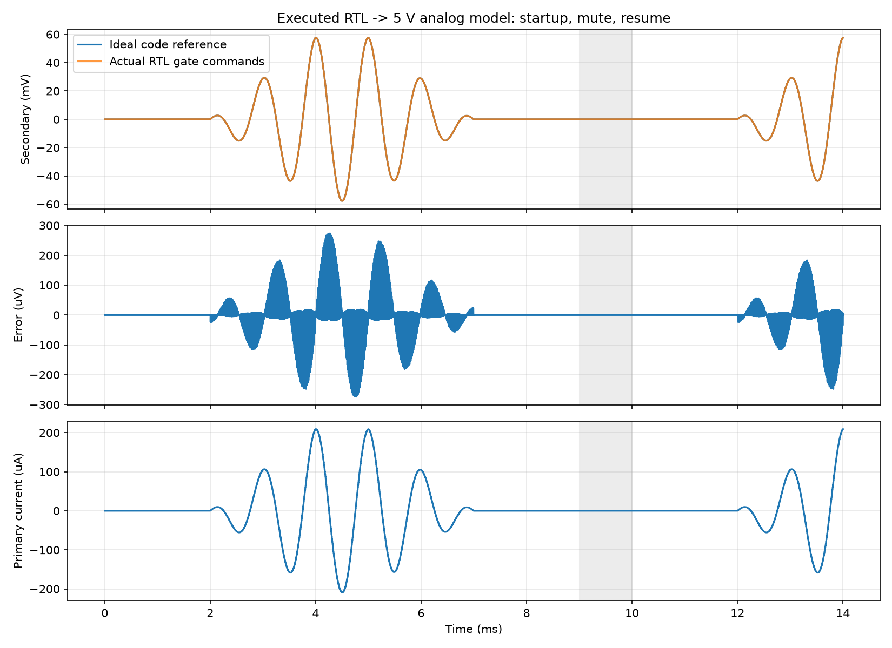

# Replay of executed FPGA mute commands

## Result and decision

All four ngspice runs passed timestep checks. The executed RTL now drives the
nominal structural model through startup, full audio, mute, quiet and resume.
Retain this result as the nominal 1 kHz reference. The later
[20 Hz study](low_frequency_mute.md) exposes magnetic tails requiring further
analog work. FPGA selection and implementation are deferred.

| Quantity | Executed result |
|---|---:|
| Secondary output peak | 57.70978 mV |
| Peak error versus ideal accepted codes | 0.273441 mV |
| Whole-record RMS error | 40.7991 uV |
| Quiet output RMS, 9.2-9.9 ms | 0.1863 uV |
| Quiet mean primary current | -0.6808 nA |
| Reference waveform refinement difference | 1.1805 uV |
| Structural peak-error refinement difference | 0.002592 uV |

The quiet values are illustrative model residuals below the global reference
error bound, not evidence of sub-microvolt hardware noise performance. Error
metrics cover the whole record and are not THD or a click-audibility measure.
This is not a new abrupt-versus-ramp comparison; the earlier 26-fold improvement
belongs to its separate stimulus and must not be attributed to this run.



## What is connected

`control/export_mute_edges.py` runs the actual `MuteController` in the Amaranth
simulator, verifies its accepted samples using the existing independent test
harness, and exports timestamped high/low gate vectors. `sim/rtl_mute_replay.py`
uses those vectors directly as the controls of the 64-switch analog surrogate.
It does not reconstruct blanking from target codes or add another dead-time
interval on top of the RTL outputs.

This is one-way digital-to-analog replay. Analog READY/FAULT feedback is not
fed back into the RTL, and no physical FPGA propagation delay is modeled.

## Reproduction

```powershell
.venv/control/Scripts/python.exe control/export_mute_edges.py
python sim/rtl_mute_replay.py
```

Inputs and results: `results/rtl_replay/`. Generated decks:
`sim/generated/rtl_replay/`. Plot: `plots/rtl_replay/comparison.png`.
The analog summary records SHA-256 hashes of both replay inputs so its results
can be associated with the exact exported command trace.

## Executed digital stimulus

- Default 384-sample ramps, 50 MHz clock, 192 kS/s requests at alternating
  260/261-clock intervals.
- 24-bit signed 1 kHz cosine at 90% amplitude; 2,688 accepted samples.
- Startup raises common mode for 2 ms, then audio gain for 2 ms.
- Mute requested at sample 960 (approximately 5 ms); fade finishes near 7 ms,
  common-mode descent near 9 ms; quiet is held until approximately 10 ms.
- Resume requested at sample 1,920; common mode rises until near 12 ms, then
  gain rises until near 14 ms.

Initialization adds a few clock periods to the nominal millisecond boundaries.
The export records integer clock cycles; cycle zero is one period before the
first recorded tick. The analog replay uses precisely those relative times.
The stimulus starts with both command vectors off, as the reset controller does.

The digital export passed 32,259 checks from the harness and contains 4,947 gate
vector changes. It checks accepted code arithmetic, branch decoding, unchanged
branch retention, ten-cycle blanking and settled commands. There are no gate
changes in the settled, supervised quiet interval. This stimulus exercises the
full default-duration startup/mute/resume cycle; the earlier verification suite
separately covers request reversals and faults.

## Analog model and reference

The model reuses the nominal 5 V 3+9 network from `quiet_transitions.py`:
0.35 ohm on resistance, 1 Tohm off resistance, fixed 20 pF per switch, generic
0.7 V / 2 ohm rail clamps, and the loaded LL1679/PP alternative-B linear model.
Primary inductance is 150 H, turns ratio 34.5, leakage 8 mH and winding DCRs
160/0.2 ohm. Core resistance 100 kohm and primary capacitance 100 pF are assumed.
The secondary load is 8 ohm. Command edges become 2 ns conductance transitions;
this leaves 198 ns fully off within a 200 ns command dead interval.

A separate ideal reference applies the accepted arm codes at their actual
request times through nominal Thevenin sources (5 * code / 4096 V). The
reference has no switch capacitance, Ron, blanking or clamp paths. Error against
it includes their combined effect and the real RTL commutation timing; it
excludes intentional changes in audio gain and common level.

Structural maximum steps are 1 us and 0.5 us; reference maximum steps are
100 ns and 50 ns. The reference waveform must change by less than 2 uV under
refinement. The structural error peak must change by less than 2 uV plus 2%.
Measurements use a 100 ns uniform interpolation grid. Quiet metrics use
9.2-9.9 ms. They are finite-window residuals, not a hardware noise floor or a
steady-state DC/saturation measurement.

## Limits

This extends the prior Python-command study to actual executed controller
outputs, but only for nominal components and timing. It does not transfer the
prior skew/mismatch or abrupt-interruption comparisons to this RTL automatically.
Other frequencies/phases, offsets, open load, asynchronous feedback, nonlinear
magnetics and vendor switch behavior remain unvalidated. Resource fit, pin
assignment and routed FPGA timing are separate tasks. The KiCad input-interface
integration is still pending. No energized HV build or PCB is included.
