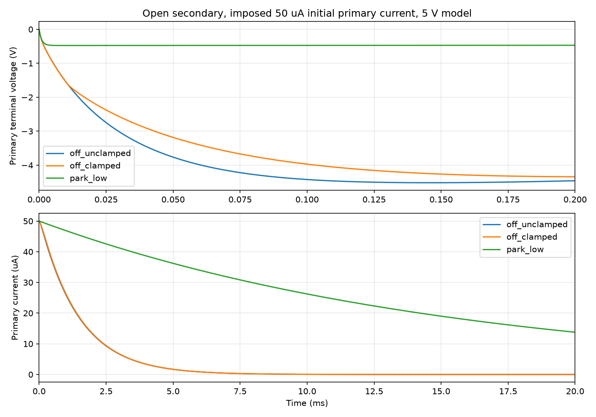

# Stored-energy release and proposed quiet state

## Decision

Retain the 3+9 architecture and 192 kS/s baseline. Investigate a dedicated
healthy-control quiet state with every upper switch off and every lower switch
on in both arms. This removes periodic code changes and differential DC drive
in the ideal steady-state network. It is a candidate, not an implemented HDL mode.
Normal PCM code zero is NOT this state: the existing complementary decoder
would drive the other arm to code 4095.

Loss of driver power or a fault is a different condition. The existing HDL
all-gates-off fault behavior is unchanged. A commanded low-side state requires
working control and bias supplies and cannot be assumed during such a fault.

## Reproduction and scope

```powershell
python sim/shutdown_study.py
```

Twenty-four ngspice transients cover three fixed switch states, 8 ohm and
1 Gohm secondary loads, both initial-current polarities, and maximum timesteps
of 2 and 1 us. Generated decks are in `sim/generated/shutdown/`; quantitative
results and the simulator log are in `results/shutdown/`.

The 5 V structural network uses the LL1679/PP alternative-B linear model:
150 H primary inductance, 34.5 turns ratio, 8 mH primary-referred leakage,
160/0.2 ohm winding resistances, assumed 100 kohm core-loss resistance and
100 pF primary capacitance. Each switch has fixed 20 pF capacitance;
on/off resistances are 0.35 ohm / 1 Tohm.

This fixture imposes +50 or -50 uA initial primary current and zero secondary
current using UIC. All branch nodes initially sit at zero; upper capacitances
start charged to 5 V. Initial magnetic energy is 0.1875 uJ, with an additional
0.008 uJ in switch capacitors. It does not start from a simulated audio waveform
and does not test entry into or exit from the quiet state.

The three states are:

- `off_unclamped`: all channel resistances off, no diode paths; a diagnostic reference.
- `off_clamped`: all channels off, with idealized rail clamps on each branch node.
- `park_low`: all lower channels on, upper channels off, with the same clamps.

Clamps conduct beyond the rails by 0.7 V with 2 ohm incremental resistance.
They are mathematical surrogates, not validated SiC body-diode models or selected
protection parts. The ideal 5 V supply can absorb returned energy. Supply collapse,
real bus energy absorption, saturation and nonlinear device capacitance are absent.
Do not scale these clamp-dependent voltage peaks directly to a 650 V design.

## Executed results

Positive initial current, 1 us maximum timestep (negative-polarity results are symmetric):

| State | Secondary load | Peak primary terminal voltage | Peak absolute device Vds | Primary current at 20 ms |
|---|---:|---:|---:|---:|
| off_unclamped | 8 ohm | 0.441140 V | 5.220560 V | 1.358512 uA |
| off_unclamped | 1 Gohm (open approximation) | 4.516675 V | 7.258273 V | 0.000056 uA |
| off_clamped | 8 ohm | 0.441140 V | 5.220560 V | 1.358512 uA |
| off_clamped | 1 Gohm (open approximation) | 4.343199 V | 5.700006 V | 0.000057 uA |
| park_low | 8 ohm | 0.280489 V | 5.000001 V | 13.138266 uA |
| park_low | 1 Gohm (open approximation) | 0.476196 V | 5.000002 V | 13.766047 uA |



With the secondary effectively open, parking low reduces the primary terminal
peak from 4.517 V to 0.476 V in this fixture. It also leaves 13.77 uA primary
current after 20 ms: low voltage does not mean the stored magnetic energy has
already vanished. With all channels off, the assumed core-loss path is a major
part of the discharge model; its real value remains unverified.

Rail clamps limit branch-node excursion to about 0.700006 V but do not clamp
the transformer terminals directly: weighted branch resistors separate those
nodes. The primary peak remains 4.343 V in the open-load clamped case.

Energy accounting includes both coupled windings (including mutual energy),
all capacitors, all resistors, clamp dissipation and signed supply energy.
The final stored energy includes capacitive energy and is not simply
0.5 * Lp * Ip squared. The numerical balance is checked against the initial
magnetic energy, and primary peak voltage is checked under timestep refinement.

Maximum energy-balance relative error: 8.46e-06; maximum primary-peak change on timestep refinement: 8.77e-05 V. All checks passed.

## Next bounded design step

Simulate audio-to-quiet and quiet-to-audio transitions with the actual 200 ns
blanking sequence. First reduce differential output, then evaluate a coordinated
common-mode move of both arms toward all-low; test arm skew and mismatch for
DC current and output clicks. Only after these tests should a dedicated quiet
state be added to HDL. Define a separate loss-of-drive case with validated
passive current paths and bus behavior. No schematic or HDL protection claim
follows from the present stored-energy fixture.
